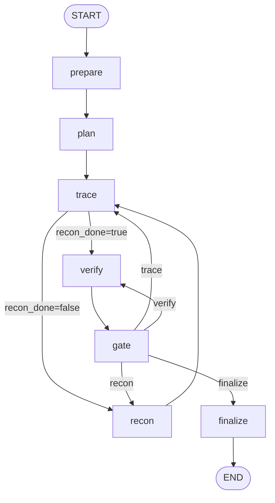

# Audit framework

The audit stage has its outer graph and artifact structure. All seven nodes are
implemented. Trace writes candidate source-to-sink flows, not findings. Recon
writes business records and follow-up questions, not findings. Verify turns
candidates into evidence-backed findings and reviews. The deterministic gate
decides audit closure, and finalize reports the gate status.

## Scope

Implemented:

- audit package and node subpackages;
- `prepare → plan → trace → recon → trace → verify → gate → finalize` graph;
- route validation and a node visit guard;
- `AuditState`, artifact paths, atomic JSON writes;
- `prepare` input resolution, discover-scope projection, confirmed-entry and
  patch-graph normalization, and the prepare checkpoint;
- `plan` seed tasks, deterministic batching, required model consolidation,
  category obligations, patch mechanism checks, and the plan checkpoint;
- `trace` per-task `prepare_task → path_scout → triage → expand/triage →
  specialists → lead → validate_persist` graph, deterministic path scouting,
  bounded triage, registry-driven specialists, candidate flows, evidence
  hydration, summaries, and trace checkpoints;
- `recon` bounded business-logic recovery, strict model-output validation,
  current-source evidence hydration, business sidecar writes, logic task
  creation, and recon checkpoints;
- `verify` candidate materialization, fresh source-backed verification,
  independent finding reviews, second-verifier adjudication for material
  disagreement, finding/review checkpoints, and verify summaries;
- `gate` deterministic input/task/check/trace/finding/review/business debt
  assessment, canonical gap handling, stable debt fingerprints, capped routing,
  and closure status without a model or tools;
- `finalize` gate-aware complete/partial artifacts, report, and handoff warnings;
- `stage.json`, `state.json`, `framework.json`, `prepare.json`, `audit.json`,
  `traces/<trace-id>.json`, `business-logic.json`, `report.md`,
  `index.json`, `validation.json`, `usage.json`;
- `RunState.audit` / `audit_mode`, audit config, `audit --run-file`,
  `run --audit-mode`.

Out of scope for this audit implementation:

- coverage reviews;
- contract validators for the final handoff;
- dynamic validation of `needs_validation` findings;
- the separate validate and report stages.

`prepare`, `plan`, and `trace` do not update `business-logic.json`; `recon`
owns its contents. Recon writes business constraints, operations,
investigations, and optional logic follow-up tasks. It does not write
`findings`. Verify materializes candidate findings and writes `findings` and
`reviews`; it does not own audit closure. Gate adds its decision to
`audit.json.gate` and writes gate-sourced gaps only when finalizing blocked
work. Finalize writes the final status from gate; `validation.json` remains
`not_run` for later dynamic validation, and the report is not a security
guarantee.

## Graph



The graph traverses every node when no later state is restored:

```text
prepare → plan → trace → recon → trace → verify → gate → finalize
```

`finalize` is reachable only from `gate`. A `finalize` request from `trace` or
`verify` is rewritten to `gate`. The outer loop guard forces `gate` after a
node exceeds four visits in the current invocation; gate applies its own
debt-fingerprint, gate-visit, and stage-budget caps before routing. Each
`run_stage` invocation resets `framework.visits` and increments
`framework.invocations`, so a resumed run does not inherit a previous
invocation's visit count. The gate fingerprint remains cross-invocation to
prevent infinite resume loops.

## Prepare

`prepare` is deterministic, sequential I/O and does not use an inner graph:

```text
resolve run inputs
  → project discover inventory into scope
  → select entries/patches/combined inputs
  → normalize current-source evidence
  → write prepare.json and audit.json
  → next_action = plan
```

- All audit modes require an existing discover stage and its
  `ledger.sqlite`. The scope is projected read-only from the ledger `files`
  table; prepare does not walk the repository, classify files, or recompute
  fingerprints.
- `confirmed-entries.json` and `patch_graphs.json` are adapted into audit entry
  and patch records. Evidence is re-read from the current source and checked
  against the discover fingerprint when one is present.
- `entries` mode fails soft when no entry is usable; `patches` mode fails soft
  when no patch graph is usable; `combined` uses whichever routes are usable
  and records the missing route as a limitation.
- A repeated run with the same input signature keeps the prepared records and
  downstream `tasks/traces/findings`. A changed input signature fails before
  writing.
- `prepare.json` records the route status, discover/current source revisions,
  scope/entry/patch counts, gaps, warnings, and the input signature.
- `business-logic.json` is not written by prepare; `recon` owns its contents.

## Plan

`plan` builds one seed task per prepared entry and patch, then runs exactly one
required model consolidation call per batch:

```text
entries/patches
  → seed tasks
  → path-bounded batches
  → model partitions/orders seed IDs only
  → final tasks + category checks + mechanism checks
  → audit.json
  → next_action = trace
```

- Seed count is `entries + patches`. Patch tasks carry every repair unit; a
  patch with no repair unit is `blocked`, gets no mechanism checks, and adds a
  plan gap.
- `AUDIT_PLAN_BATCH_SIZE` (default `100`) bounds each batch. Batches are
  deterministic, path-bucketed, and never merge across batches or kinds.
- The model sees compact task metadata only: IDs, kind, status, paths, entry
  or patch IDs, and summaries. It does not receive source code, CWE details,
  category checklists, findings, or business records.
- The model must use every seed ID exactly once, group only same-kind tasks,
  keep groups at most four tasks, require a common path for merged groups, and
  return a complete order. Any violation is a hard failure before writing.
- There is no fallback on missing configuration or invalid output. A missing
  key/model raises `PlanConfigurationError`; invalid output raises
  `PlanModelError`. Transient 429/5xx model failures are retried with the shared
  `RetryPolicy` and `AGENT_MODEL_RETRIES`; 400/401/403 fail without retry.
  Provider-level retries are disabled (`max_retries=0`) to avoid double
  retries.
- The model only partitions and orders seed IDs. Paths, entries, patches,
  repair units, and priorities come from validated seed data.
- Entry tasks receive one category check per baseline category. Merged entry
  groups receive one set, not one set per seed. Patch tasks with repair units
  receive `original_path`, `bypass`, and `same_mechanism` checks.
- `categories.json` is the plan-facing category manifest. The detailed
  `category_details.json` CWE/check catalog is execution-facing and is not
  loaded by `plan`.
- `plan` writes only `audit.json`; there is no `plan.json`. Existing tasks or
  `framework.plan_done=true` reuse the checkpoint without a model call. The
  business sidecar is never written by `plan`.

## Trace

`trace` is an outer routing node with an inner per-task state graph. The first
call is a no-op to `recon`. After `recon_done=true`, it runs planned,
deferred, partial, or failed tasks; complete and blocked tasks are skipped:

```text
task
  → prepare_task
  → path_scout (YASA call graph + source excerpts)
  → triage (tool-free, max 2 rounds, 12 units/round)
  → specialists (registry-selected, max 3, concurrency 2)
  → lead (full checks and candidate flows)
  → validate_persist (artifact + compact checkpoint)
```

- `path_scout` uses YASA structural navigation for callers/callees and source
  reads for excerpts. YASA is not taint analysis; missing or truncated graphs
  are recorded as `dynamic_suspected`.
- Triage judges intermediate units reached from the entry or patch unit. It
  does not gate the task as a whole. Patch repair units are never skipped.
  Triage may expand missing callees for at most one additional round.
- The default specialist registry contains `identity`, `boundary`, `dynamic`,
  and `patch`. Patch is mandatory for patch tasks. A specialist is selected
  only when triage delegates its role and the registry says it applies to the
  task kind. Adding a lens requires a registry entry and prompt file; the graph
  and triage parser do not change.
- Specialists use source, YASA, and (for patch) read-only Git tools. They may
  return candidate flows, observations, unit results, and behavior summaries.
  They do not write findings.
- The lead owns every required category or mechanism check. Missing checks are
  persisted as `pending`, not silently closed. A mechanism `found` outcome needs
  a complete flow; `not_found` needs current-source evidence.
- When gate reopens a task with `action=trace`, trace injects a bounded
  `repair` block (debt IDs/reasons, prior trace ID, prior gaps) into triage and
  lead. The lead must return one `repair_responses` item per debt with
  `resolved|unresolved|not_applicable` and a reason. The response is validated
  and recorded; it is diagnostic only, because gate still decides closure from
  actual coverage.
- Rejections with a complete independent review are exposed as bounded
  `known_rejections` in triage and lead. This is negative memory, not a hard
  block: a new current-source fact can still justify re-reporting the flow, and
  the prompt requires the contradicting evidence.
- Candidate flows carry source, sink, steps, guards, reachability,
  triggerability, confidence, preconditions, unknowns, and current-source
  evidence. Proven unreachable or non-triggerable paths are not written.
  `completeness=source_only|sink_only` forces `reachability=unknown`.
- Behavior summaries are condition-scoped and stored by
  `sha256(run_id + revision + path + function_fqn + content_hash)`. Exact reuse
  for a check or flow also requires checked conditions; flow reuse requires a
  current-source re-read. Patch checks cannot be closed by summary reuse.
- One `AuditBudget` from `AUDIT_TIMEOUT` bounds the whole stage. Each task gets
  a `TaskBudget` capped by `AGENT_HARD_TASK_CAP`. `AUDIT_MAX_AGENTS` bounds task
  concurrency; `AUDIT_MODEL_CONCURRENCY` bounds model calls across concurrent
  task and specialist loops. A runnable task without a configured model raises
  `TraceConfigurationError`.
- `AUDIT_MAX_TOTAL_TOKENS` and `AUDIT_MAX_TOTAL_COST` are optional soft caps
  checked before the next model call. A recorded call can overshoot once.
  Cost enforcement requires a usage price table; token accounting falls back to
  estimated prompt tokens when provider usage is absent.
- Logic tasks from recon read only their referenced business records. They
  do not create category or mechanism checks and do not turn candidate flows
  into findings.
- The outer checkpoint stores compact traces; full traces live under
  `stages/audit/traces/`. Trace merges preserve `findings` and `reviews` for
  `verify`.

## Verify

`verify` consumes full candidate flows from `traces/<trace-id>.json`; compact
trace records in `audit.json` are not enough. It writes one deterministic
candidate finding per unique flow before calling a model. Candidate keys cover
category, kind, source/sink anchors, reachability, triggerability, and
prerequisites, so paths that differ on any of those remain separate.

Each candidate gets a fresh verifier with source tools and optional YASA
tools. The verifier must return `confirmed`, `rejected`, or
`needs_validation`, with current-source evidence and an explanation. Evidence
is hydrated from the current checkout. A confirmed result needs a successful
`read_file` receipt covering each evidence path and a complete finding review
by an independent reviewer. A rejected result also needs a complete
independent review; a rejected finding without one is reviewed first rather
than re-verified. If the review materially disagrees with either verdict, a
second fresh verifier adjudicates; a failed or incomplete second pass leaves
the finding unconfirmed with a deferred review.

Verify reuses the audit budget, `AUDIT_MAX_AGENTS`, and `AGENT_HARD_TASK_CAP`.
There are no verify-specific settings. Invalid output, missing evidence,
unavailable model calls, and exhausted budget keep candidates or rejected
review work visible rather than fabricating findings. A source revision
mismatch fails the stage and asks for a new run. Reruns reuse terminal findings
and complete reviews; candidates continue verification, and rejected findings
without a complete review continue review. Verify writes no separate artifact.

## Gate

`gate` is a deterministic closure controller. It reads the persisted audit,
verify inputs, business sidecar, and trace artifacts; it does not call a model,
prompt, tool, or subagent. It writes no `gate.json`; the decision lives in
`audit.json.gate`.

Debt is stable and typed: inputs without tasks, incomplete or blocked tasks,
incomplete category/mechanism obligations, non-coverage-complete traces, trace
flows without materialized findings, candidates, confirmed or rejected findings
without a complete review, and business gaps. Missing-review debt routes to
`verify`, not `finalize`. A task with `patch.status=not_applicable`
and no repair units is the only accepted blocked task. A `needs_validation`
finding is terminal for verify and does not block closure; it is recorded under
`validation_pending` for later dynamic validation.

Routing priority is `trace` > `verify` > `recon` > `finalize`:

- a complete task missing obligations or a coverage-complete trace is reopened
  to `partial` and routes to `trace`;
- a candidate or missing finding routes to `verify`;
- a missing business sidecar may route to `recon` while recon has not run;
- blocking debt that cannot be repaired by a route goes to `finalize` with
  `partial`; a repeated debt fingerprint, gate-visit cap, or exhausted stage
  budget also closes as `partial`.

`complete` requires no blocking debt and an empty canonical `audit.gaps` list.
It means the recorded static audit scope is closed, not that the repository has
no vulnerabilities. Gate writes canonical `{id, source, reason, paths}` gaps
for unresolved blocking debt when it closes as `partial`.

## Finalize

`finalize` reads `state.gate` or `audit.json.gate` and uses that status for
`audit.json`, `index.json`, `stage.json`, and `report.md`. It never upgrades a
gate `partial` and falls back to `partial` when no gate decision exists. It
preserves the business sidecar's own status instead of overwriting it, and
keeps `validation.json` at `not_run` with a warning that dynamic validation and
external contract validation are pending. It writes no coverage review.

## Recon

`recon` runs after the first trace and before the second trace. It is a single
bounded agent over a compact seed, not a per-task graph:

```text
audit scope + entries + patches + tasks
  + first-trace traces and summaries
  + project overview
  + existing complete business sidecar
  → one cartographer agent with source/YASA/(read-only Git) tools
  → strict validation and current-source evidence hydration
  → business-logic.json + logic tasks
  → recon_done=true
  → trace
```

- The model is a hard dependency when business tasks exist. Missing model,
  request failure, invalid JSON, invalid references, invalid evidence, and
  empty business output raise `ReconConfigurationError`, `ReconBudgetError`,
  or `ReconModelError`. A failed recon writes no sidecar, does not set
  `recon_done`, and does not route to trace.
- If no entry, patch, or runnable task exists, recon is a deterministic no-op:
  it writes an empty `complete` sidecar and does not call a model.
- A valid result can be `partial` when it contains real `unknown` or
  `deferred` investigations, gaps, or logic tasks. That is business
  uncertainty, not a model-failure fallback.
- Current-source evidence is re-read and hydrated into `path`, line range,
  `code`, and explanation. Historical patch or overview references are kept
  separately and never used as current proof.
- `business-logic.json` is canonical. `audit.json` stores only a `recon`
  summary and the logic tasks; it does not copy business arrays.
- Recon does not create category or mechanism checks. `state_workflow_business_logic`
  remains trace-owned. A logic task must concern a cross-task/cross-operation
  business question; duplicate questions are skipped.
- The second trace reads only the business records referenced by a logic task.
  It skips complete entry/patch tasks and does not turn candidate flows into
  findings.

## Node status

| Node | Current behavior | Next discussion |
| --- | --- | --- |
| `prepare` | Resolves init/discover inputs, projects the discover scope, normalizes entries/patches, writes `prepare.json` and the audit checkpoint. | Input changes, scoring, and extraction checks belong to later nodes. |
| `plan` | Builds seed tasks, batches them, requires model consolidation, writes tasks/category checks/mechanism checks. | Later trace consumes the plan; plan refinement and cross-batch policy remain out of scope. |
| `trace` | Routes to `recon` before recon, then runs path scouting, triage, specialists, lead, and validation; consumes gate repair debt, writes candidate flows and compact traces, and injects reviewed rejections as negative memory. | Verify consumes candidates; trace does not create findings. |
| `recon` | Recovers business constraints, operations, investigations, and logic tasks; writes `business-logic.json`; sets `recon_done=true` and routes to trace. | Verify consumes business records and logic task results; recon does not create findings or a business graph. |
| `verify` | Materializes candidate findings from full trace flows, runs a fresh verifier, requires a complete independent review for both confirmed and rejected results, reviews rejected findings without re-verifying, and adjudicates material disagreement with a second verifier. Routes to `gate`. | Gate consumes terminal findings and unresolved `needs_validation`; verify does not own audit closure. |
| `gate` | Deterministically assesses closure debt, reopens repairable tasks, routes to trace/verify/recon, and issues a stable complete/partial decision. | Final handoff contract validators remain out of scope. |
| `finalize` | Writes gate-aware final artifacts, report, index, and validation warning without overwriting business status. | Dynamic validation and report are separate stages; audit never writes their artifacts. |

## Artifact skeleton

```text
stages/audit/
├── stage.json
├── state.json
├── framework.json
├── prepare.json
├── audit.json
├── traces/
│   └── <trace-id>.json
├── business-logic.json
├── report.md
├── index.json
├── validation.json
└── usage.json
```

`audit.json` keeps the legacy fields (`scope`, `entries`,
`patches`, `tasks`, `traces`, `category_checks`, `mechanism_checks`,
`summaries`, `findings`, `reviews`, `gaps`). `prepare` fills `scope`, `entries`,
`patches`, and prepare-sourced `gaps`; `plan` fills `tasks`,
`category_checks`, `mechanism_checks`, and appends plan-sourced `gaps`; `trace`
updates checks, adds compact `traces` and `summaries`, and appends trace-sourced
`gaps`; `recon` writes the business sidecar, adds a `recon` summary and logic
tasks, and appends recon-sourced `gaps`. `verify` materializes and updates
`findings`/`reviews`, writes the `verify` summary, and appends verify-sourced
`gaps`. `gate` adds the `gate` summary, canonical gate-sourced gaps only for
blocked finalization, and closed/reopened task status; `finalize` writes no
separate artifact. Every checkpoint records `execution.executed_nodes` and
`execution.implemented_nodes`; implementation status covers all seven nodes
independently of runtime execution.

`plan` has no `plan.json`. The plan summary lives in `state.json`/`stage.json`;
the durable task and obligation records live in `audit.json`.

## Commands

```bash
# Five-stage run. Audit prepare runs without a model; plan, trace, and recon
# require one when business tasks exist.
yasa-vulnagent run /path/to/repository

# Run or resume the audit stage from an existing run.
yasa-vulnagent audit --run-file /path/to/run.json

# Choose the audit input route for a new run.
yasa-vulnagent run /path/to/repository --audit-mode combined

# Bound plan model batches.
AUDIT_PLAN_BATCH_SIZE=100 yasa-vulnagent audit --run-file /path/to/run.json
```

Audit settings: `AUDIT_MODE`, `AUDIT_TIMEOUT` (stage-wide budget),
`AUDIT_RECURSION_LIMIT`, `AUDIT_MAX_AGENTS` (task concurrency),
`AUDIT_PLAN_BATCH_SIZE`, `AUDIT_MODEL_CONCURRENCY` (model-call concurrency),
`AUDIT_MAX_TOTAL_TOKENS` and `AUDIT_MAX_TOTAL_COST` (soft caps; `0` disables).

## Per-node definition of done

For each node, settle its inputs, outputs, failure behavior, and tests before
implementing it. A node is done when:

1. its implementation is complete without changing unrelated nodes;
2. its canonical writes are validated and idempotent;
3. its routing works with the existing graph contract;
4. tests cover the happy path and at least one explicit limitation;
5. the artifact and README/docs describe the new behavior.

Dynamic validation of `needs_validation` findings belongs to the later
`validate` stage, outside this audit implementation.
