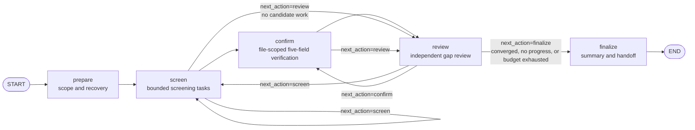
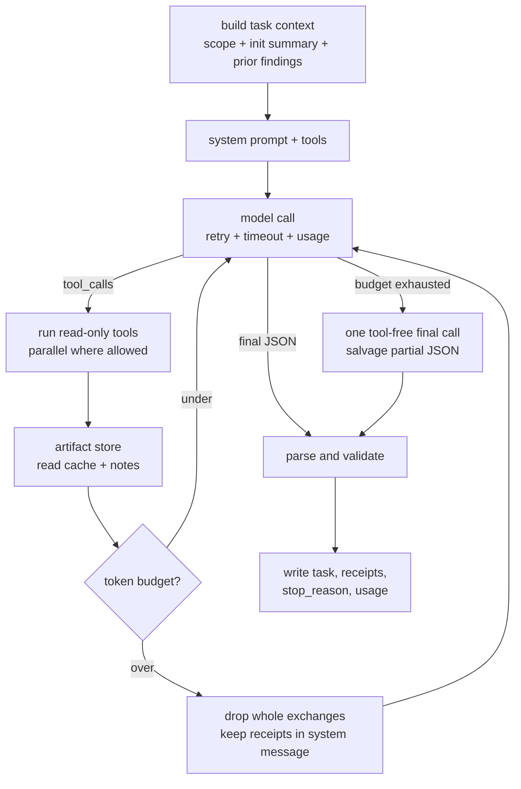
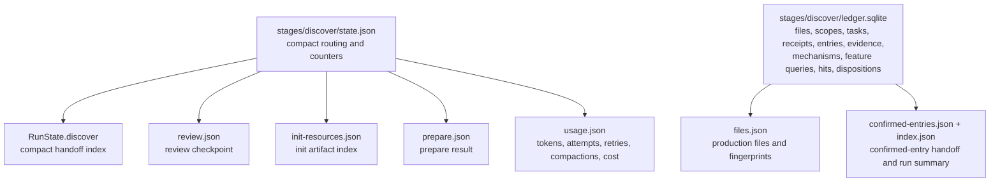

# discover stage flowcharts

Discover uses one outer LangGraph and a run-local ledger shared by screening, confirmation, review, and finalization.

## Inside the prepare node

```mermaid
flowchart LR
    PSTART([prepare]) --> CHECK[validate repository and existing init handoff]
    CHECK --> RES[index init artifacts\nread on demand and record gaps]
    RES --> ENUM[tracked Git files + unignored files\nfilesystem fallback for non-Git repositories]
    ENUM --> CLASS[type and usage hints\ntext fingerprints and binary metadata]
    CLASS --> LEDGER[upsert inventory into run-local SQLite ledger]
    LEDGER --> RECOVER[recover running tasks → pending\nkeep receipts and gaps in ledger]
    RECOVER --> WRITE[write compact state and boundary JSON exports]
    WRITE --> PEND([screen])
```

This version assumes unchanged source code during recovery; it does not implement source-change detection or invalidation propagation. Tests, examples, and documentation are retained and marked as reference material, while screen decides whether to read them.

## Outer orchestration

Outer routing is driven by the `next_action` returned by each node. Screen and confirm emit feature observations; the shared feature service validates mechanisms, runs bounded production-text queries, and materializes hits as candidate entries plus file-scoped confirm tasks. Review repairs open handoffs and missing/incomplete feature queries before model review, validates disposition evidence, and routes candidate/handoff/confirm debt to confirm and other debt to screen. Loop protection hashes a compact ledger progress digest and routing summary rather than serializing the inventory or task payloads; when the same node requests continuation without a durable change, routing is forced to `finalize` with the `no_progress` stop reason.

## Shared task loop

Screen, confirm, planner, and review all run one task through the same loop.

- A dropped exchange always removes the assistant `tool_calls` message together with its `ToolMessage` results, so the next request stays valid for OpenAI-compatible APIs.
- `stop_reason` is one of `complete`, `step_budget`, `round_limit`, `time_budget`, `tool_calls`, or `error`. Only `complete` can produce a `complete` task; everything else stays `partial` with a `partial_summary`.
- Task notes and prior findings are re-injected after compaction. They are leads, not coverage evidence.

## Persistence boundary

`RunContext` provides only runtime dependencies such as the model, API key, and MCP connection; it is not written to the JSON files above. The SQLite ledger is local to one run and is queried through stable cursors; screen task prompts receive scope references rather than full path lists. JSON files are limited to the inventory snapshot, the confirmed-entry handoff, the run summary, and prepare reports; tasks, candidates, evidence, dispositions, mechanisms, and feature queries are queried from the ledger. Oversized tool outputs are stored under `tool-results/` and referenced by the agent loop, not exported as a summary.
