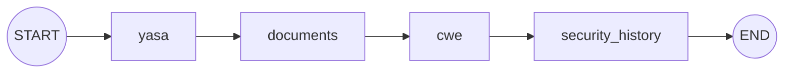
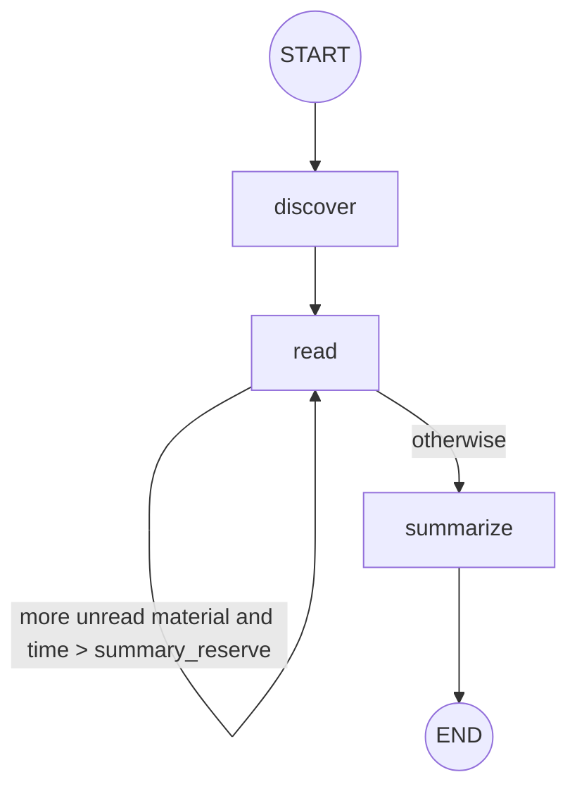
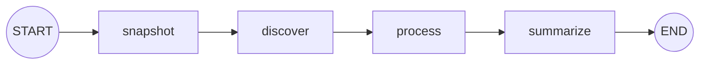
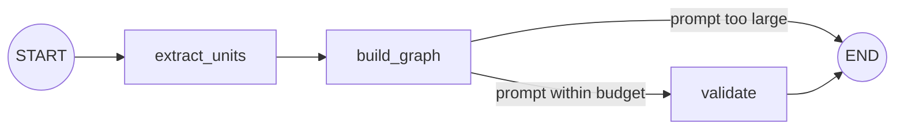

# init LangGraph flowcharts

These diagrams show only the nodes registered through the current `StateGraph.add_node()` calls, LangGraph's `START`/`END` sentinels, and the edges defined by `add_edge()` and `add_conditional_edges()`. Tools, models, concurrent tasks, and artifact writes performed inside a node are not drawn as separate nodes; the notes below each diagram describe them.

## 1. init graph

Corresponds to `build_init_graph()` in [stages/init/graph.py](../src/yasa_vulnagent/stages/init/graph.py).

`yasa` and `cwe` are single nodes in the init graph and currently have no independent LangGraph subgraphs. The `documents` and `security_history` nodes call their respective subgraphs from inside the node function; this does not add nodes to the init graph.

## 2. documents subgraph

Corresponds to `build_documents_graph()` in [stages/init/documents/graph.py](../src/yasa_vulnagent/stages/init/documents/graph.py).

The `read` self-loop and its branch are controlled by `_next_node`, which returns `"read"` or `"summarize"`. `_next_node` is a routing function, not a separately registered LangGraph node. File reads, segmentation, model calls, and synthesis inside `discover`, `read`, and `summarize` remain node implementation details and do not expand the graph topology.

## 3. security_history subgraph

Corresponds to `build_security_history_graph()` in [stages/init/security_history/graph.py](../src/yasa_vulnagent/stages/init/security_history/graph.py).

The `process` node uses a thread pool for multiple candidate commits; per-commit review is not a separate graph node. Only commits classified as `security_fix` invoke the patch graph from within `process`. A single-commit failure, timeout, or unavailable Git operation is recorded as a result or warning inside the node and does not become a LangGraph conditional edge.

## 4. patch graph subgraph

Corresponds to `build_patch_graph()` in [stages/init/security_history/patch_graph.py](../src/yasa_vulnagent/stages/init/security_history/patch_graph.py).

`extract_units` reads multiple segments bounded by diff regions. Before synthesis, `build_graph` estimates the prompt against `AGENT_CONTEXT_TOKENS` and `AGENT_COMPACTION_TRIGGER`; an oversized prompt ends the subgraph as `partial` with `patch_graph_prompt_too_large` instead of sending a known-oversized request. `validate` performs deterministic checks and may make one model correction before validating again. Apart from that guard edge, the subgraph registers no retry loop or self-loop.
