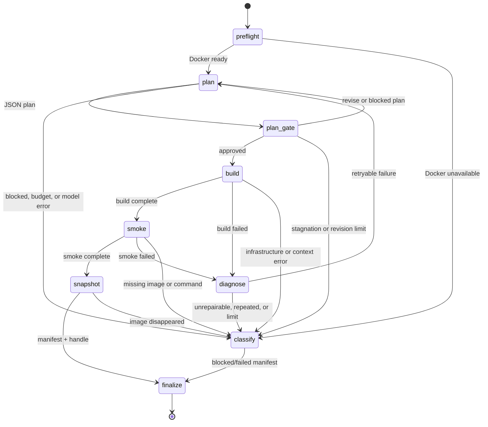

# validate environment flow

The environment builder is a separate subgraph under `stages/validate/environment/`. It turns a live repository into a reusable Docker image handle. It does not execute application services or decide whether a finding is valid.

## State graph

Only `plan` and `diagnose` call a model. Routing is driven by each node's `next_action`; Docker flags, context filtering, smoke isolation, and all gate rules are deterministic.

## Node responsibilities

| node | responsibility | artifacts |
| --- | --- | --- |
| `preflight` | Check CLI, daemon, socket, group, buildx; record a specific failure kind and remediation. | `preflight.json`, `state.json` |
| `plan` | Read the live repository with read-only tools, propose a Dockerfile and argv smoke commands, cite read receipts. | `plans/NNNN.json`, `plans/NNNN.receipts.json` |
| `plan_gate` | Reject unsafe paths/instructions, require evidence and smoke, clamp resources, record quality warnings. | `gates/NNNN.json`, `plans/NNNN.effective.json` |
| `build` | Render the Dockerfile, copy a filtered context, compute a hash, run `docker build`, inspect the image. | `Dockerfile`, `dockerignore`, `attempts/NNNN/build.{log,json}` |
| `smoke` | Run argv commands with no network, dropped capabilities, `no-new-privileges`, pid/memory/cpu limits, and `--rm`. | `attempts/NNNN/smoke.{log,json}` |
| `diagnose` | Inspect the failure log and repository, decide retryability, and request a bounded plan revision. | `attempts/NNNN/diagnosis.json` |
| `snapshot` | Re-inspect the image and write the ready manifest and handle. | `environment.json`, `handle.json` |
| `classify` | Write a terminal blocked/failed manifest and remove a stale handle. | `environment.json` |
| `finalize` | Write the durable state, usage, index, and environment stage record. | `state.json`, `usage.json`, `index.json`, `stage.json` |

## Boundaries

- The plan cannot request privileged mode, host network, host mounts, host namespaces, devices, Docker sockets, or secrets.
- The build context excludes `.git`, dependency caches, common build outputs, `.env`, keys, credentials, and symlinks outside the repository.
- The build may use the network to install dependencies. Smoke has no network.
- The repository is read live; it is not snapshotted. `source_revision` is recorded as metadata, with no source-drift comparison or warning.
- A ready `handle.json` means an image was built and smoke-tested. It does not mean application-level isolation or vulnerability validation passed.
