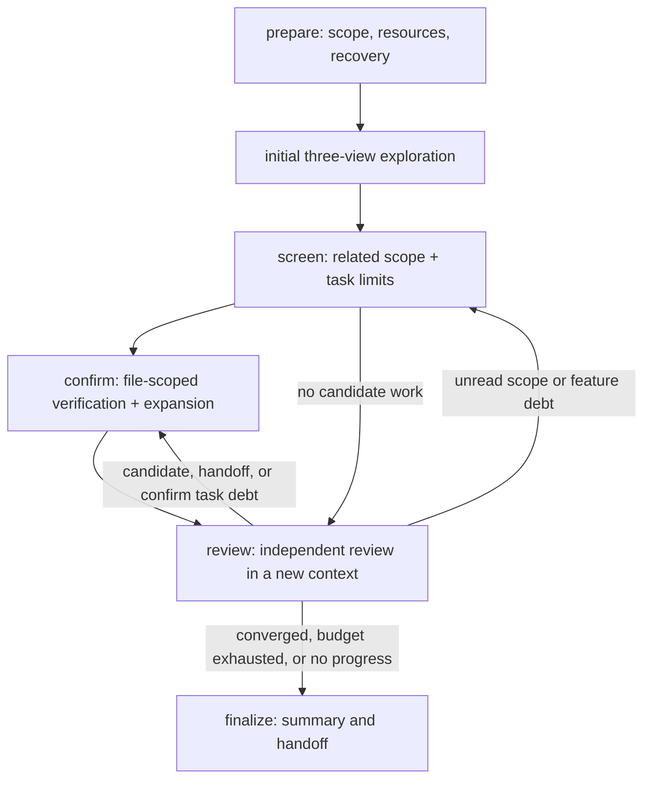

# discover stage

discover identifies external input entries in production code and records input sources, parameter binding, activation conditions, trust boundaries, and traceable evidence. Public APIs exposed by libraries for external use also count as entries; architecture diagrams and mechanism models are not independent artifacts of this stage.

The current recoverable LangGraph outer graph is:

```text
prepare → screen → confirm → review → finalize
             ↑          │        │
             └──────────┴────────┘
```

The current `prepare` is a deterministic LangGraph node. It indexes init artifacts, enumerates tracked Git files and unignored files (with a filesystem fallback for non-Git directories), records file types and usage hints, and recovers the persistent task ledger. Tests, examples, and documentation are retained as reference material; binaries receive metadata only. Known VCS data, dependencies, caches, and runtime outputs are recorded with exclusion reasons. Source-change invalidation is outside this version; recovery assumes unchanged source code, and fingerprints are used for provenance only.

The implementation is split by outer discover node:

```text
discover/
├── node.py                 # stage entry and RunState handoff
├── graph.py                # outer LangGraph orchestration
├── schema.py               # DiscoverState and record types
├── storage.py              # atomic JSON persistence and compact summary
├── ledger.py                # run-local SQLite inventory, tasks, receipts, notes, and evidence
├── agent.py                 # shared discover task loop: context, budget adapter, retries
├── prepare/
│   ├── node.py             # init handoff, recovery, and prepare result
│   └── inventory.py        # Git/filesystem inventory and type detection
├── screen/
│   ├── node.py             # wave scheduling, three-view merge, and planner handoff
│   ├── graph.py            # task execution, prompt assembly, and result validation
│   ├── harness.py          # wave budgets, parallel execution, and recovery
│   ├── tools.py            # bounded source tools, read cache, notes, and YASA adapters
│   ├── mcp.py              # per-wave MCP session lifecycle
│   ├── model.py            # model construction and prompt loading
│   ├── planner.py          # bounded work selection and task proposal validation
│   ├── repo_map.py         # deterministic repository map and planner tools
│   ├── SKILL.md            # human method note; prompts/screen.md is the contract
│   └── prompts/{screen,planner}.md
├── features/               # observations, bounded queries, candidates, confirm tasks
│   ├── query.py            # literal/token/regex source queries with cursors
│   └── service.py          # observation validation and query-hit materialization
├── confirm/
│   ├── node.py             # file-scoped candidate confirmation and expansion
│   └── prompt.md           # five-field and evidence contract
├── review/
│   ├── node.py             # independent debt review and disposition audit
│   ├── tools.py            # bounded debt-source reads
│   └── prompts/review.md
└── finalize/node.py
```

Outer nodes select the next step through `next_action`, allowing loops among `screen`, `confirm`, and `review`. When the same node requests continuation without a business-state change, or review requests another non-finalize round with an unchanged fingerprint, loop protection routes to `finalize` and preserves a `no_progress` gap. A completed task artifact restored after an interruption is committed through the ledger, then its unprocessed feature observations and follow-ups are replayed; derived work is never discarded just because the task row already exists. `screen` implements the initial three views and later bounded waves: it runs a model/tool loop through a single-task LangGraph subgraph, saves source read ranges, tool receipts, candidates, negative results, and unknown/deferred items, and falls back to source tools when YASA is unavailable. After the initial wave, a planner selects pending work and may propose bounded, grounded screen tasks; the deterministic fallback never invents new work. Screen and confirm may emit structured feature observations. The shared feature service validates the observation, runs one bounded query over ledger-authorized production text, and turns deduplicated hits into candidate entries plus file-scoped confirm tasks. Query hits and confirm reads are leads, not screen coverage.

`confirm` runs bounded file-scoped tasks, checks the current file for sibling handlers, wrappers, and registration, requires five source-backed fields for `confirmed`, downgrades unsupported claims to `unknown`, and emits same-file or broad screen scope as follow-up work. `review` audits unread files, candidates, unfinished tasks, mechanisms, queries, hits, handoffs, and completed-task follow-ups; it automatically repairs missing mechanism queries and incomplete query cursors, validates disposition evidence, and routes candidate/handoff/confirm debt to confirm and other debt to screen. Source-priority hints only affect model ordering; ignoring them is a warning, not coverage evidence. Open handoffs block completion until confirm consumes them.

## Migration reference: screen / confirm / review

The following records the implemented design. `screen`, `confirm`, `review`, and `finalize` share the ledger and bounded task interface.



### screen: discovery and screening (first version implemented)

- The initial wave has three independent analysis tasks: component/runtime, input/boundary, and one independent broad exploration. The tasks run in parallel with isolated conclusions; their proposed scope, candidates, and confirmation questions are merged only after all three current attempts finish.
- Later screening advances through related scope rather than a fixed file count. Related scope may come from initial candidates, call or registration relationships, same-file expansion, or review gaps; task rounds, model calls, and tool-output limits bound how much source one task reads.
- The LLM proposes scope, priority, and next steps. The program owns task deduplication, queueing, task limits, retries, persistence, and recovery. Screening results must record read ranges, candidates, negative results, unknowns, and deferred items and must not state a vulnerability conclusion.
- Tasks rotate through bounded waves so that a large component cannot occupy the queue indefinitely. Each wave decides whether to create the next batch; scope is not expanded merely to fill a batch.

### confirm: verification and expansion

- For each candidate, verify the input source, registration or call relationship, activation conditions, parameter binding, participant controls, and trust boundary, retaining evidence that points back to source locations.
- The current task first checks nearby methods, annotations, wrappers, and registration points in the same file. Cross-file, cross-component, or out-of-scope work becomes a new follow-up task rather than being silently absorbed.
- After a task obtains source-supported mechanism evidence, such as an annotation, wrapper, or registration pattern, it may issue a bounded text query and turn each hit into an independent confirm/expand task. A query hit is a candidate lead, not proof of an entry or vulnerability; the query tool does not perform semantic interpretation.
- confirm must distinguish `confirmed`, `not_applicable`, `unknown`, and `deferred`; lack of evidence is not evidence of absence. `unknown` and `deferred` are terminal and never mean absence has been proved.
- Each confirm task is limited to one file and a bounded candidate list. A task may schedule same-file expansion or a broad screen task, but only a screen task can create file-coverage receipts.

### review: independent gap review

- Start review when the known queue is temporarily empty or planner work has stagnated. Each review wave uses a fresh context to check unread files, candidate entries, and unfinished tasks against the current source and ledger.
- Review may read only debt-related source within its task limits; those reads are evidence, not file-coverage receipts. It can close debt with `not_applicable` or `deferred`, create bounded screen tasks, or hand a candidate to confirm. It cannot mark a file or candidate `covered`.
- A handoff immediately creates a confirm task and is marked consumed; it never closes the candidate. Open handoffs, pending confirm tasks, and all other debt must be zero before finalize can report completion. Deferred and unknown items are exported, not treated as negative proof. Budget exhaustion and no progress mean only that the run is `partial`; gaps, open items, and the stop reason must be preserved.

### Shared harness: task loop, context, and memory

Screen, confirm, planner, and review all call the same loop in `agent/runtime.py` through
`stages/discover/agent.py::run_task_agent` (async) or `run_task_agent_sync`. The loop is:

```text
assemble task context → model analysis ⇄ bounded source/YASA tools → compact context → validate result → write ledger and create follow-up tasks
```

- The loop is async; read-only tools run concurrently through `asyncio.to_thread`, and all nodes share the same retry, timeout, and usage-recording behavior. The sync wrapper tolerates an active event loop.
- `ContextManager` compacts on token budget at whole tool-exchange boundaries, never splitting an assistant `tool_calls` message from its `ToolMessage` results. Dropped exchanges leave a receipt, including target paths and artifact references.
- `ToolResultStore` writes oversized tool results to `tool-results/` and exposes `read_tool_result`; the model reads a bounded window instead of receiving a truncated string.
- `ScreenBudget` and `PlannerBudget` are mapped onto `TaskBudget` by `SharedBudgetAdapter`, so timeout, model-call, read-character, and round limits have one implementation.
- When a budget is exhausted the loop makes one final tool-free model call and records `stop_reason`, `partial_summary`, `rounds`, `model_calls`, and `compactions` on the task. Finalize can therefore salvage partial work instead of discarding it.
- Task context is built from the ledger scope reference, optional init summaries, prior read ranges, and `prior_context_for_task`: negative results and entries from other tasks sharing the same scope. These are labelled leads, not facts. Independent views do not receive them.
- Large `init_context` values and confirm candidate payloads are serialized by `compact_json`, which drops optional subtrees and trims long strings while keeping valid JSON. Prompts are never cut mid-JSON.
- The model may call `save_note`; notes live in the run-local ledger (`task_notes`, capped per task) and are injected back after compaction. Notes are agent scratch state, not evidence.
- `search_text` skips files above `DISCOVER_SEARCH_MAX_FILE_BYTES` and stops after `DISCOVER_SEARCH_MAX_SCAN_FILES` with a resumable cursor. `read_file` and `search_text` share a per-wave `ReadCache`, so one file is parsed once per wave.
- Every model call is recorded by `UsageRecorder`; the stage writes `usage.json` and includes token, attempt, retry, compaction, tool-call, and cost totals in the stage summary.
- Each task persists its type and parent/child relationship, read ranges, tool-call summary, candidates/negative results, evidence references, unknown or deferred reasons, follow-up tasks, and completion state. Review can recheck the task in a new context instead of relying on the previous model's memory.

### Completion conditions and boundaries

File coverage and candidate handling must be counted separately:

- A file is closed only after an explicit complete screen inspection, an accepted review disposition, or terminal confirm entries for all candidates in that file. Creating a task, partially reading a file, or receiving an empty query result does not close it.
- discover can report `completed` only when every target production file and candidate has a valid disposition, the initial three views are complete, no unresolved task remains, no open handoff remains, and review has converged. `unknown` and `deferred` are terminal and permit completion; they remain exported and are not proof of absence.
- When time or model-call budgets are reached, progress stops repeatedly, tools fail, or sufficient evidence cannot be obtained, report `partial` and save the gaps and stop reason. “No candidates found” must not be written as “absence has been proved.”
- A LangGraph recursion-limit stop is normalized through `finalize` with forced partial status. It still writes the inventory, index, and confirmed-entry export, and preserves `stop_reason=recursion_limit` instead of claiming completion.

### Recommended migration order

1. The ledger and the shared task interface hold inventory, tasks, candidates, evidence, mechanisms, queries, hits, and dispositions.
2. Screen covers initial views, related-scope scheduling, feature observations, and bounded source/YASA tools.
3. Confirm consumes candidates and review handoffs, performs same-file expansion, and records five-field confirmation evidence.
4. Review repairs feature queues, validates dispositions and evidence, and returns unfinished work to screen or confirm.

Wave and task limits are configuration, not protocol: `DISCOVER_SCREEN_WAVE_TIMEOUT`, `DISCOVER_SCREEN_WAVE_MODEL_CALLS`, `DISCOVER_SCREEN_WAVE_MAX_TASKS`, `DISCOVER_SCREEN_TASK_MAX_ROUNDS`, and `DISCOVER_RECURSION_LIMIT`. Defaults are a starting point; tune them after measuring tool and model behavior.

Stage-wide budgets are checked at each review boundary: `DISCOVER_TIMEOUT` (wall clock, seconds) and `DISCOVER_MAX_TOTAL_TOKENS` (input+output tokens), both with 0 meaning unlimited. When a budget is exhausted, review routes to `finalize`, records the reason in `stop_reason` and `gaps`, and keeps the work done so far; a resumed run starts a fresh timeout window.

Stage state is stored under `stages/discover/` in the run directory.

`state.json` stores only the ledger path, counters, current node's `next_action`, compact summaries, and loop-protection state. The run-local `ledger.sqlite` owns the growing inventory, task queue, scopes, read receipts, task notes, candidates, evidence, and full gap list. Tool connections, model objects, and other runtime dependencies remain only in `RunContext`.

```text
state.json          # compact recoverable DiscoverState
ledger.sqlite       # run-local growing state and indexed scope queries
files.json          # boundary export of the file inventory
excluded-files.json  # VCS/cache/dependency/runtime-output exclusions
init-resources.json  # init artifact index and availability
prepare.json         # prepare result, gaps, and recovery count
screen/tasks/        # receipt and result for each screen task
screen/waves/        # wave budget and completion summary
review.json          # review checkpoint
confirmed-entries.json  # confirmed entries with five-field evidence (audit handoff)
index.json           # compact handoff index for audit
usage.json           # token, attempt, retry, compaction, tool-call, and cost totals
tool-results/        # oversized tool results referenced by the agent loop
```

Only the file inventory and the confirmed-entry handoff are exported as JSON. Tasks,
candidates, evidence, dispositions, mechanisms, and feature queries live in
`ledger.sqlite` and are queried there; there is no JSON mirror to keep in sync.
